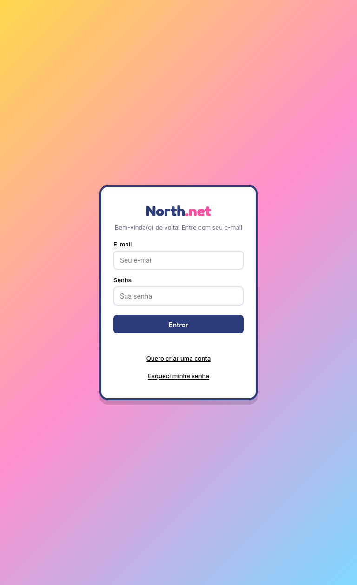
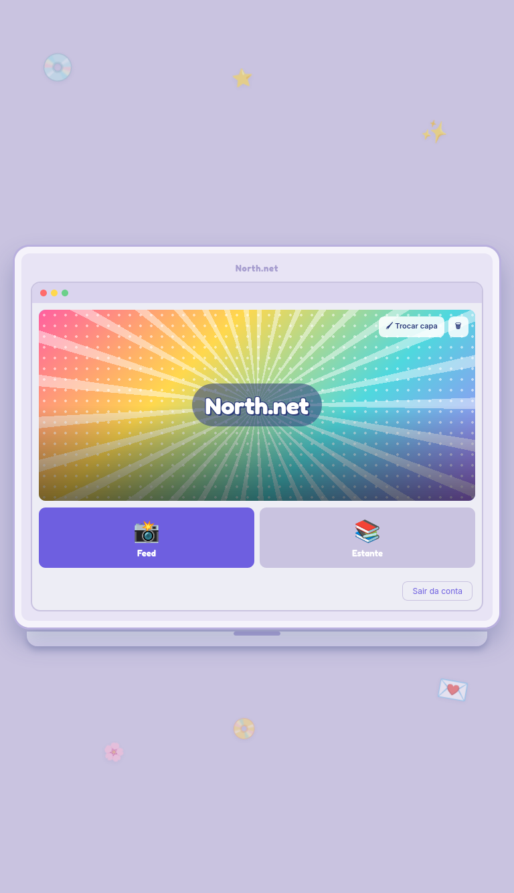
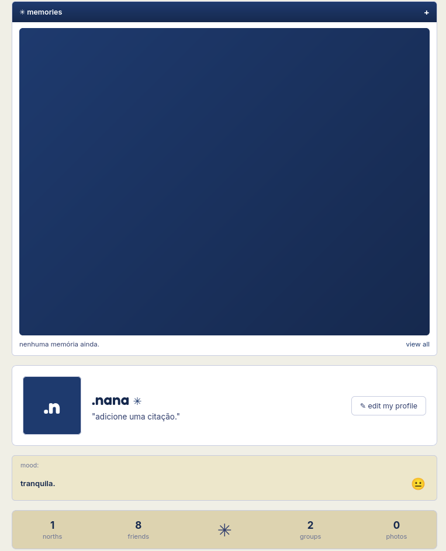
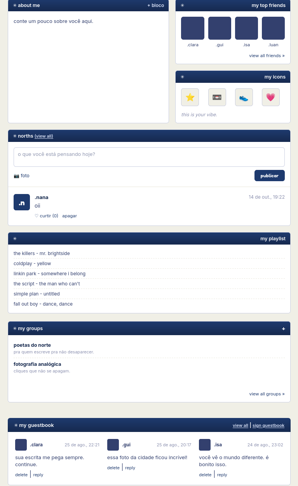
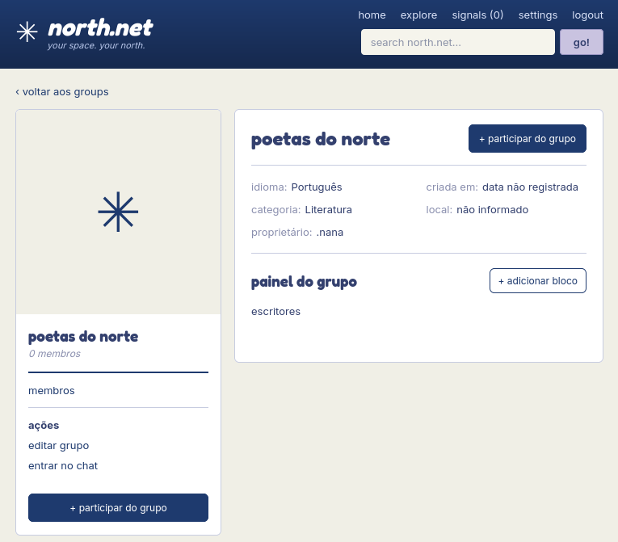

# North.net

North.net é uma rede social autoral em desenvolvimento, inspirada na experiência e na estética das redes sociais dos anos 2000 e início dos anos 2010.

O projeto combina elementos inspirados em plataformas como Orkut e redes sociais modernas, reunindo perfis, publicações, grupos, memories, guestbook e outras formas de interação em uma interface própria.

## Sobre o projeto

O North.net nasceu como um projeto pessoal para explorar o desenvolvimento de uma rede social desde sua concepção, passando pelo planejamento das funcionalidades, criação da interface e implementação da lógica da aplicação.

Atualmente, o projeto utiliza HTML, CSS e JavaScript no front-end e Supabase para autenticação de usuários, enquanto outras partes da aplicação continuam sendo desenvolvidas e gradualmente integradas ao backend.

Além de ser uma aplicação em desenvolvimento, o North.net funciona como um projeto prático de aprendizado em desenvolvimento web, autenticação, persistência de dados e versionamento de código.

## Funcionalidades

O North.net já conta com diferentes recursos inspirados na experiência de redes sociais:

-  Cadastro, login e recuperação de senha com Supabase Auth
-  Perfil personalizável com nome, foto, citação, mood e seção "about me"
-  Criação de norths (publicações) com texto e imagens
-  Sistema de curtidas em publicações
-  Memories com fotos e legendas
-  Criação e gerenciamento de grupos
-  Guestbook para recados e respostas
-  Personalização da capa do portal
-  Ícones de perfil personalizáveis
-  Área de configurações da conta
-  Exportação dos dados do usuário em JSON

Algumas funcionalidades ainda estão em desenvolvimento, incluindo a expansão da integração com o Supabase, North.fm, playlist, Explore, Signals e Minha Estante.

## Tecnologias

- HTML5
- CSS3
- JavaScript (ES6)
- Supabase
- Supabase Auth
- Git
- GitHub

## Screenshots

### Autenticação e portal

<p align="center">
  
  
</p>

### Feed e perfil

<p align="center">
  
  
</p>

### Grupos

<p align="center">
  
</p>

## Como executar

1. Clone este repositório:

   ```bash
   git clone https://github.com/geovannagoms/north-net.git

   ## Status do projeto

🚧 **Em desenvolvimento**

O North.net está em desenvolvimento ativo. A autenticação de usuários com Supabase já está funcional, enquanto outras partes da aplicação ainda utilizam armazenamento local e estão sendo gradualmente integradas ao backend.

A interface, as funcionalidades e a estrutura do código também continuam sendo aprimoradas conforme o projeto evolui.

## Próximos passos

- Expandir a integração dos dados com o Supabase
- Desenvolver o North.fm e o sistema de playlist
- Implementar Explore e Signals
- Expandir a área Minha Estante
- Refatorar e organizar partes da estrutura JavaScript
- Continuar aprimorando responsividade e interface

## Autora

Desenvolvido por **Geovanna Soares Gomes**.

- GitHub: [@geovannagoms](https://github.com/geovannagoms)
